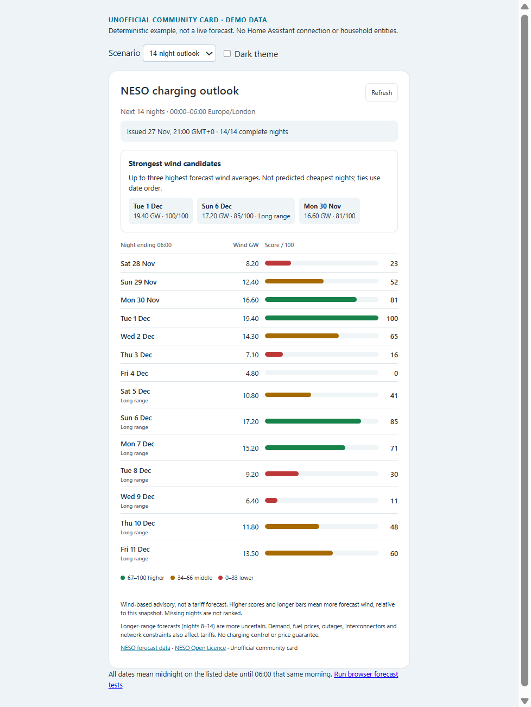

# NESO charging outlook

Unofficial, standalone Home Assistant dashboard card. It fetches NESO's national
wind forecast directly from your browser and shows the **next 14 nights,
00:00-06:00 Europe/London**, with average wind GW and a relative 0-100 charging
score. No entities, integration, API key, tariff service or vehicle are required.
It never schedules or controls charging.



Screenshot: the actual card rendered with demo data, not a live tariff or forecast.

Repository: [bennthomsen/neso-ev-charging-outlook](https://github.com/bennthomsen/neso-ev-charging-outlook).
This card has not been approved for the Marketplace catalog. Publishing a branch
does not create a release or establish catalog acceptance.

## Install now, manually

1. Copy the single root file `neso-ev-charging-outlook.js` into your Home Assistant
   configuration directory as `www/neso-ev-charging-outlook.js`. Create `www` if needed.
2. In **Settings > Dashboards > Resources**, add
   `/local/neso-ev-charging-outlook.js?v=0.1.0` as a **JavaScript module**.
   Resource settings may require Advanced Mode on your user profile. With
   YAML-managed resources, use the equivalent entry below.
3. Reload the browser, edit a dashboard, and choose **NESO charging outlook** in
   the card picker, or add the card YAML below.

```yaml
type: custom:neso-ev-charging-outlook
title: NESO charging outlook
```

`title` is the only card-specific option and is optional. The visual editor can
change it. No entity selectors or household configuration exist.

```yaml
# Only for YAML-managed Lovelace resources:
lovelace:
  resources:
    - url: /local/neso-ev-charging-outlook.js?v=0.1.0
      type: module
```

For updates, replace the JS file and change the resource version query to clear
the browser cache. Removing the card and its resource uninstalls it; there are no
server-side entities to clean up. Do not load two copies of different versions.

## Marketplace / HACS installation, after publication

Once a release exists, add `https://github.com/bennthomsen/neso-ev-charging-outlook` to
HACS's custom repositories using category **Dashboard** (internal category
`plugin`), install the card, and confirm the module resource was registered.
Use the same card YAML above. The root `hacs.json` declares the single installable
module. There is no build step and no runtime dependency on Home Assistant's Lit.

Custom repository installation is separate from searchable Marketplace catalog
inclusion. Catalog inclusion later needs a reviewed submission, public repository
metadata, a passing HACS action, a full release (not just a tag), and a real
screenshot. This local package is not a claim of catalog acceptance.

## Method and limitations

- Each date means **midnight on that date until 06:00 that same morning**. Today's
  already-started window is excluded. Dates and boundaries use Europe/London,
  regardless of the device timezone.
- NESO's `Datetime` and `ForecastDateTime` without an offset are interpreted as
  UTC. Wind and capacity arrive in MW; the display converts the nightly mean
  to GW. A complete night has exactly one valid sample per expected half-hour:
  normally 12, 10 at the spring DST change and 14 at the autumn change.
- For valid nights, score is
  `round(100 * (average - minimum) / (maximum - minimum))`.
  Higher wind = higher score and a longer bar. Even a small nonzero spread uses
  the whole 0-100 scale. Displayed GW is rounded; scoring uses unrounded averages.
  Green is >=67, amber is >33 and <67, red is <=33.
- If all valid averages are identical (including all zero, or only one complete
  night), every valid night scores 50 and an explicit **no preference** message
  replaces the strongest-candidates list. Otherwise up to three highest wind
  averages are shown, with tied averages ordered by date.
- Zero forecast wind is valid. Missing, duplicate, off-grid, negative,
  nonnumeric or above-capacity samples, or nonpositive capacity, invalidate the
  affected night, not other complete nights. Hover or screen-reader text on
  **No signal** explains missing coverage. Missing nights are never treated as
  zero wind or as cheap charging.
- Only the latest forecast issue is used; older issues cannot fill its gaps.
  The fetched record count must equal NESO's reported total. Empty/truncated
  responses and invalid timestamps are rejected visibly. Forecasts older than
  6 hours or more than 15 minutes in the future show no recommendation.
- The card fetches when attached, on manual refresh, and every 30 minutes.
  It rechecks dates and freshness every minute, so recommendations expire even
  if the next fetch fails. Requests time out after 20 seconds and are aborted
  when the card is removed. A failed refresh clears previous recommendations.
- Nights 8-14 are marked **Long range** and are more uncertain. The source is a
  rolling 0-14 day forecast; depending on its current horizon, the last overnight
  window may be incomplete and correctly show no signal.

**This is a wind-based indicator, not a tariff forecast or guaranteed cheap
charging.** The scale is relative to the current valid forecast snapshot, not an
absolute measure of grid conditions. Demand, fuel prices, outages,
interconnectors and network constraints also affect tariffs. There are no assumed
p/kWh prices, battery calculations, vehicle schedules or charging controls.

## Data, privacy and licences

Source: [NESO 14-days-ahead wind forecasts](https://www.neso.energy/data-portal/14-days-ahead-wind-forecasts).
Data is attributed to NESO under the separate
[NESO Open Licence](https://www.neso.energy/data-portal/ngeso-open-licence).
The MIT licence in [LICENSE](LICENSE) covers this software, not NESO's data.
No official Home Assistant or NESO endorsement is implied.

The card uses the public CKAN `datastore_search` endpoint at `api.neso.energy`,
resource `93c3048e-1dab-4057-a2a9-417540583929`, `limit=1000`, with fields
`_id,Datetime,Wind_Forecast,ForecastDateTime,Capacity`. `_id` is required for
NESO's total-count query. No authentication is requested or sent. The source
currently permits cross-origin browser requests; availability and CORS policies
can change. Your browser contacts NESO, exposing ordinary request metadata such
as its IP address; no household entities, credentials or telemetry are sent.

## Development and local preview

Node.js 22+; no dependencies or installation step:

```text
npm run check
npm test
npm run preview
```

Open `http://127.0.0.1:8124/`. The preview uses clearly labelled,
deterministic **demo data**, intercepting only NESO requests in that demo page.
Its clock is fixed to 27 November 2026. It is not a live outlook. Test missing
coverage, identical averages, stale data, network failure and dark theme using
the controls. The browser tests are at `/tests.html`. Stop the server with
Ctrl+C. The server listens only on localhost and is not a Home Assistant proxy.

The production JS itself is the installable output. Tests exercise UTC/DST
boundaries, tomorrow-only windows, exact coverage, latest-issue selection,
zero/invalid wind, scoring, staleness, the endpoint, and fetch failure/cancellation.
The browser suite additionally checks actual card rendering, narrow layout,
the visual editor, HA updates without refetching, polling overlap, clock expiry,
failed refreshes, request abortion, timer cleanup and reconnection.
The validation workflow checks syntax, packaging and tests, then runs HACS's
plugin validation. It only uploads a workflow artifact; **it does not publish a
release**.

## Gated release checklist

1. Verify the intended GitHub account is `bennthomsen` using an explicitly
   authorized account connection. Do not publish under another CLI account.
2. With release publication authorized, verify the repository description,
   MIT licence, relevant topics and repository URL in docs.
3. Run local checks, test in a real Home Assistant dashboard, add a real
   screenshot, and obtain passing HACS validation. A demo is not an HA integration
   test.
4. Create a full GitHub release, attach `neso-ev-charging-outlook.js`, and verify
   manual and HACS custom-repository installs. Do not merely create a tag.
5. Separately request reviewed catalog inclusion following
   [dashboard guidance](https://contributors.home-assistant.io/marketplace/guides/dashboard/)
   and [catalog guidance](https://contributors.home-assistant.io/marketplace/guides/catalog/).

The local tooling does not change accounts, push commits, create repositories,
publish releases or submit the card to the catalog.
